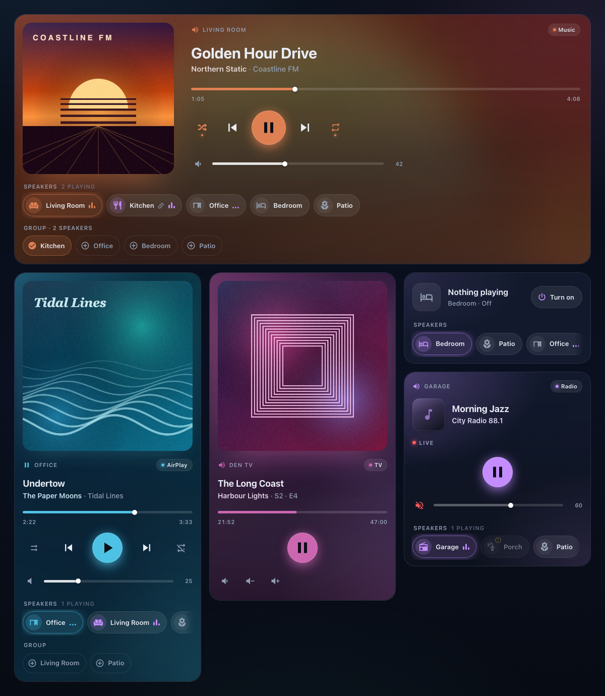

# Glasshouse Media Card

A now-playing card for Home Assistant that replaces the stock media cards. It shows large artwork with
a soft glow taken from the cover's colours, a live progress bar, transport controls sized for thumbs,
volume, a speaker switcher and Sonos-style grouping. Part of the **Glasshouse** suite: refined dark
glass, one accent per device type, live numbers.



## Features

- **Now playing:** large artwork (`entity_picture`; relative proxy URLs are resolved with
  `hass.hassUrl()`), title, artist · album (or series · season · episode for TV), and a source/app chip.
- **Colour from the cover:** the card samples the artwork's dominant colour (on a tiny canvas) and uses
  it for the backdrop glow, progress bar, play button and active states. The blurred cover also sits
  behind the glass. When the artwork comes from another origin without CORS headers, the card falls back
  to the Glasshouse media accent (`--gh-media`).
- **Live progress** from `media_position`, `media_position_updated_at` and `media_duration`, interpolated
  while playing. The ticker only runs while the card is on screen, the tab is visible and something is
  playing. Drag or tap the bar to seek when the player supports it. Streams without a duration show a
  **Live** badge instead.
- **Transport:** previous / play-pause / next, plus shuffle and repeat (off → all → one) toggles. Each
  control only appears when the player's `supported_features` include it. Tapping the artwork plays or
  pauses; holding it opens more-info. When paused, the artwork settles back slightly.
- **Volume:** slider plus mute. The slider follows your finger locally and calls `volume_set` once, on
  release; the new value stays on screen until the player reports it. Players that can only step volume
  get − / + buttons.
- **Speaker switcher:** a chip per configured player, with a small equaliser that dances while that
  speaker plays. Tap a chip to make it the active player, hold it for more-info. Speakers grouped with
  the active one carry a link badge.
- **Grouping:** when the active player exposes `group_members` (Sonos, Linkplay, Music Assistant and
  others), a **Group** row shows a toggle per speaker that calls `media_player.join` /
  `media_player.unjoin`.
- **Idle / off:** a compact "Nothing playing" row with the speaker chips still usable, and a **Turn on**
  button for an off player that supports it.
- **Layouts:** at 640 px and wider the artwork sits on the left with the controls on the right. On
  narrower cards the artwork is a square on top. Without artwork, a small tile keeps the card compact.
- Sections view ready (`columns: 12`, `min_columns: 6`, `rows: auto`), from phone width (360 px) to wide
  desktop columns. Keyboard and screen-reader friendly. Respects `prefers-reduced-motion`.
- No dependencies, no build step: one JavaScript file.

## Installation

### HACS (custom repository)

1. HACS → ⋮ → **Custom repositories**.
2. Add `https://github.com/petergCA/glasshouse-media-card` with type **Dashboard**.
3. Install **Glasshouse Media Card**, then reload the browser.

### Manual

1. Copy `glasshouse-media-card.js` to `config/www/`.
2. Settings → Dashboards → ⋮ → **Resources** → add `/local/glasshouse-media-card.js` as a
   **JavaScript module**.

For the full look, pair it with the **Glasshouse** theme.

## Configuration

| Option | Type | Default | Description |
|---|---|---|---|
| `type` | string | **required** | `custom:glasshouse-media-card` |
| `players` | list | **required** | `media_player` entities, as ids or objects (below). The card shows one active player at a time. |
| `default` | `auto` or entity | `auto` | Which player is active first. `auto` = the most recently changed playing player, else the first one. In `auto` mode the card also moves to a player that starts playing while the active one has nothing on, until you pick a speaker yourself. |
| `show_volume` | boolean | `true` | Show the volume slider and mute button. |
| `show_group` | boolean | `true` | Show grouping toggles when the active player has a `group_members` attribute. |

A single player can also be given as `entity: media_player.x` instead of `players`.

Player object options:

| Option | Type | Description |
|---|---|---|
| `entity` | entity | **Required.** A `media_player` entity id. |
| `name` | string | Display name (defaults to the friendly name). |
| `icon` | string | Chip icon (defaults to the entity's state icon). |

### Gestures

| Target | Tap | Hold (500 ms) |
|---|---|---|
| Artwork | Play / pause | More-info |
| Speaker chip | Make it the active player | More-info for that speaker |
| Player name (top line) | More-info | – |
| Progress bar | Seek (release to apply) | – |
| Volume slider | Set volume (release to apply) | – |

### Theming

Every design token can be overridden from a theme with a `glasshouse-*` variable, for example
`glasshouse-surface`, `glasshouse-radius`, `glasshouse-text-2` and `glasshouse-media` (the fallback
accent when no colour can be read from the artwork).

## Examples

One speaker:

```yaml
type: custom:glasshouse-media-card
players:
  - media_player.kitchen
```

Whole house, with grouping:

```yaml
type: custom:glasshouse-media-card
players:
  - entity: media_player.living_room
    name: Living Room
    icon: mdi:sofa
  - entity: media_player.kitchen
    name: Kitchen
    icon: mdi:silverware-fork-knife
  - entity: media_player.office
    name: Office
    icon: mdi:desk
  - entity: media_player.bedroom
    name: Bedroom
    icon: mdi:bed-outline
default: auto
show_volume: true
show_group: true
```

A TV that always opens first, no grouping row:

```yaml
type: custom:glasshouse-media-card
players:
  - entity: media_player.den_tv
    name: Den TV
    icon: mdi:television
  - media_player.den_soundbar
default: media_player.den_tv
show_group: false
```

## Development

`test/harness.html` renders the card offline with stub `ha-card` / `ha-icon` / `ha-state-icon`
elements, a mock `hass` (`test/mock-hass.js`, generic demo data whose `callService` updates the players,
including join/unjoin) and album covers painted on a canvas at load. Open it in a browser:

- `?layout=phone&scene=playing` one card at phone width. Scenes: `playing`, `paused`, `idle`,
  `grouped`, `tv`, `radio`.
- `?layout=desktop&scene=grouped` a wide card above a row of section-width cards.
- `?preview` the composition used for `docs/preview.png`.

`test/shot.sh` takes headless Chrome screenshots of the harness. `test/interaction.test.cjs` covers
progress interpolation, feature-bit gating, player switching, volume-on-release, seeking, grouping, the
idle view, diffing and config validation under jsdom (`npm i jsdom` in a scratch directory, then run it
from there with node).

## License

MIT © Peter Gray
